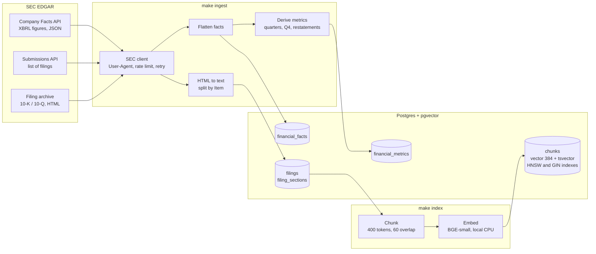
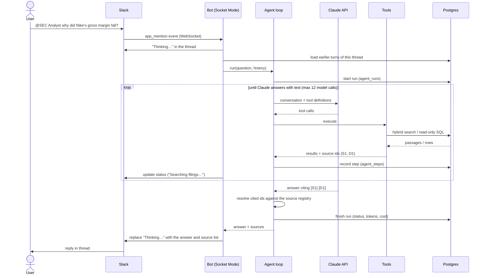
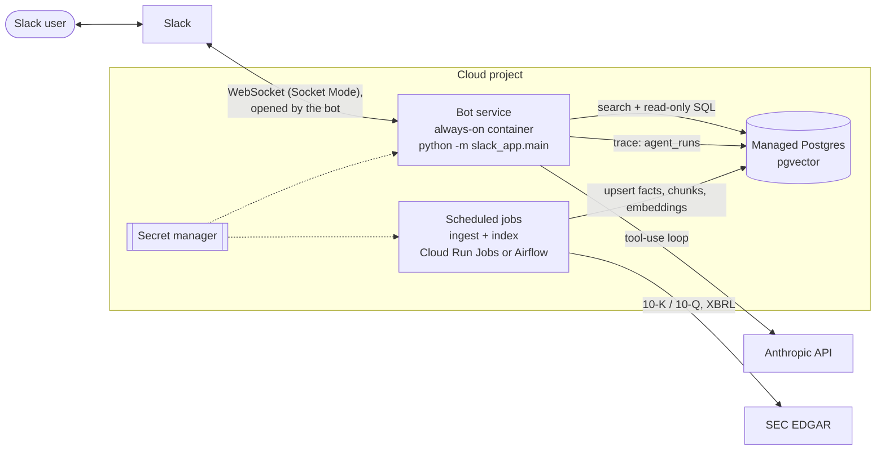

# SEC Analyst Agent

A Slack bot that answers questions about US-listed companies from their SEC filings, and shows where every statement came from.

Ask it *"Why did Nike's gross margin fall over the last three quarters, and what did management say about it?"* and it pulls the reported figures from XBRL data, computes the margins, finds management's explanation in the 10-Q, and replies in the thread with the filings it used. If the filings do not contain the answer, it says so.

It is a learning project and a portfolio piece: retrieval-augmented generation, hybrid search, a tool-using agent and evals, built from first principles on Postgres, without an agent framework.

## What a question looks like

The agent decides its own path. This is the trace of the Nike question above, as printed by `make ask`:

```
model   -> query_financials   revenue and gross profit by quarter (SQL)
model   -> calculator x7      gross margin of each quarter, in parallel
model   -> search_filings     "gross margin decreased reasons", NKE, FY2026-27
           query_financials   cross-check the derived Q4 figure
model   -> search_filings     explanation for the latest quarter
model   -> calculator x3      change in percentage points
model   -> final answer       with [S..] and [D..] citations
```

6 model calls and 14 tool executions in 31 seconds, for \$0.17. The answer challenged the premise of the question (only one of the last three quarters had declined), attributed the earlier decline to tariffs as management did, and flagged one figure it considered unreliable.

## Architecture

Two independent paths share one Postgres database: a batch path that ingests and indexes filings, and an online path that answers questions.

### Ingestion and indexing



### Answering a question



## How it works

**Data.** Two official, free SEC sources for five companies (NKE, AAPL, MSFT, KO, TSLA; configurable in `config/companies.yaml`): the XBRL Company Facts API for figures and the 10-K / 10-Q documents for text. The current index holds 137,898 raw facts, 60 filings from the last three years, and 7,542 chunks.

**Figures.** Raw XBRL facts are not directly usable for "the last three quarters": a 10-Q reports the quarter and the year-to-date amount under one tag, filings repeat and restate prior periods, the fiscal labels describe the filing rather than the fact, and the fourth quarter is never reported on its own. `ingestion/xbrl/metrics.py` resolves this into one value per company, metric and fiscal period, with provenance for citations.

**Retrieval.** Filings are split by Item (MD&A, Risk Factors, ...), then into chunks of whole paragraphs. Each chunk is embedded together with a one-line context header (company, form, period, section). Search runs a vector query (HNSW, cosine) and a full-text query (GIN) over the same filtered rows and merges them with Reciprocal Rank Fusion; a cross-encoder re-ranker is optional.

**Agent.** A hand-written tool-use loop over the Anthropic Messages API (`agent/loop.py`, about 200 lines) with three tools: `search_filings`, `query_financials` and `calculator`.

**Citations.** Tools register every passage and query result and hand the model a short id. The model cites ids inline; the source list shown to the user is built by code from the registry, never from text the model wrote. An id that no tool returned is detected and flagged.

**Interface.** A Slack Bolt app in Socket Mode: replies in a thread, shows what the agent is doing while it works, and keeps follow-up questions in context.

`docs/CONCEITOS.md` (in Portuguese) explains each concept with examples from this codebase.

## Quickstart

Requires Docker. Three credentials go in `.env` (created on first `make up`):

| Variable | Needed for | Where to get it |
|---|---|---|
| `SEC_USER_AGENT` | `make ingest` | Your own contact string, e.g. `Your Company you@example.com` (required by the SEC) |
| `ANTHROPIC_API_KEY` | `make ask`, `make slack`, `make eval` | console.anthropic.com |
| `SLACK_BOT_TOKEN`, `SLACK_APP_TOKEN` | `make slack` | [docs/SLACK_SETUP.md](docs/SLACK_SETUP.md) |

```bash
make up              # Postgres + pgvector, migrations
make ingest          # XBRL facts and 10-K/10-Q filings (a few minutes; cached on disk)
make index           # chunk and embed (about 5 minutes on a laptop CPU)

make search Q="why did gross margin decline" ARGS="--ticker NKE --year 2026"
make ask Q="How did Apple's revenue change over the last three fiscal years?"
make slack           # run the bot

make eval-retrieval  # retrieval eval, free
make eval            # full eval, calls the Anthropic API
make test            # unit and integration tests
make lint            # ruff + mypy --strict
```

## Design decisions

| Decision | Why | Trade-off |
|---|---|---|
| Postgres + pgvector for everything | One query filters by ticker and ranks by similarity; relational facts, vectors, full-text and traces live in one transactional store | Not the fastest vector engine at very large scale |
| Hybrid search with RRF | Vector search finds paraphrases, keyword search finds exact terms; RRF merges ranks, so the two score scales never need calibrating | Two queries per search |
| pgvector iterative scan | A filtered HNSW query otherwise returns too few rows when the nearest neighbours belong to another company | Needs pgvector 0.8+ |
| Section-aware chunks with a context header | A chunk like "gross margin decreased 120 bps" does not say whose or when; the header puts that into the vector | Re-embedding when the header format changes |
| SQL tool instead of putting numbers in the vector index | Semantic search is unreliable for exact figures; SQL is exact and can aggregate | The model writes SQL, which needs guarding |
| Three layers around model-written SQL | A parser-level allow-list gives the model actionable errors; a read-only role and a statement timeout hold even if the parser check is wrong | More moving parts than one check |
| Curated `financial_metrics` table | Encodes the XBRL pitfalls once, with tests, instead of hoping the model handles them in every query | Covers six metrics; anything else needs the raw facts |
| Hand-written agent loop | Every step is visible, traceable and testable with a scripted model; nothing is hidden in a framework | Features like streaming would be built by hand |
| Source ids assigned by code | The model cannot invent a citation that looks real | Checks that a source exists, not that the claim matches it |
| Local embedding model behind a `Protocol` | Free, private, reproducible; one class to swap for a hosted API | About 3 GB of image for PyTorch, CPU-bound indexing |
| Integration tests on a separate database | Indexing and search scan whole tables and commit, so they must never see real data | A second database to migrate |

## Eval results

The eval set has 22 questions (`evals/dataset.yaml`) in four kinds: figures, filing text, both, and questions the data cannot answer. Every expected value was read from the ingested data.

### Retrieval

For the 10 questions answered from filing text: where does the first relevant passage rank? A passage is relevant when it comes from the expected filing and contains the key sentence. No LLM is involved.

| Setup | hit@1 | hit@3 | hit@5 | hit@10 | MRR |
|---|---|---|---|---|---|
| Vector only | 30% | 80% | 80% | 100% | 0.58 |
| Keyword only | 30% | 60% | 80% | 100% | 0.52 |
| Hybrid (RRF) | 60% | 100% | 100% | 100% | 0.80 |
| Hybrid + re-ranker | 70% | 90% | 100% | 100% | 0.82 |

Hybrid search puts a relevant passage in the top 3 for every question, which neither retriever does alone. The re-ranker gains one question at rank 1 and loses one from the top 3, at about 0.7 s per search on CPU, so it stays off by default.

Read these numbers with two caveats. Ten questions means each one moves a rate by 10 points. And the search queries were written by someone who had already seen the target passages, so they are closer to the filing's wording than a real user's would be; the absolute rates are optimistic, while the comparison between setups is on equal terms.

### Answers

The whole agent answers each of the 22 questions once (`claude-opus-5-5`, effort `medium`, re-ranker off). Each answer gets programmatic checks read from the run, and a verdict from an LLM judge (`claude-sonnet-5-5`) against the expected facts. Before grading, the judge itself is checked on six control answers: it must pass a perfect answer and fail an empty one, an "I could not find it", a confident answer to a different question, and a fabricated answer to an unanswerable question. It passed all six.

| Measure | Result |
|---|---|
| Correct, questions the data can answer | 17 / 18 |
| Said "not available", questions the data cannot answer | 4 / 4 |
| Cited at least one source (answerable questions) | 18 / 18 |
| Cited the expected filing (questions answered from text) | 10 / 10 |
| Runs citing a source id that no tool returned | 0 / 22 |
| Median per question | 8.9 s, 5 steps, \$0.06 |
| Cost of the full run, agent plus judge | \$1.34 |

**The one miss was a defect in the eval, not in the agent.** The question asked for Microsoft's stake in OpenAI without a date. The expected answer said about 25%, taken from the fiscal 2026 10-K. The agent answered about 24%, from a 10-Q filed three months later, and also gave the 25% figure with its date. The agent was right and the expected answer was stale. The case now pins the date, and on a re-run the agent answered it correctly. The table above shows the original run.

**Using the eval to make a change: answer length.** The first answers were too long for a chat thread: a median of 197 words, 271 for questions answered from filing text. The system prompt was changed in two steps, and the eval was re-run after each.

| Prompt | Median words | Text questions | Longest | Correct | Abstained |
|---|---|---|---|---|---|
| "As short as the question allows" | 197 | 271 | 352 | 17 / 18 | 4 / 4 |
| Lead with the answer, 3 to 5 bullets, offer detail instead of including it | 155 | 213 | 294 | 18 / 18 | 4 / 4 |
| Same, plus "about 120 words, 200 as the ceiling" | 138 | 167 | 226 | 18 / 18 | 4 / 4 |

Describing the shape of a good answer helped; a concrete word target helped more. Answers to text questions got 38% shorter with no loss of correctness or citations on this set. The 17 / 18 in the first row is the stale expected answer described above, not an effect of the prompt.

**What these results do and do not show.**

- The eval is close to its ceiling, so it can catch a regression but cannot rank two good configurations. It needs harder cases: multi-company comparisons, questions spanning several years of text, and trick premises.
- Each question ran once. Agent runs are not deterministic, and without repeats there is no measure of run-to-run variation.
- The questions were written by the system's author after reading the data. They cover what the system was built for.
- The judge was validated on six probes, not against a human-graded sample.
- Nothing here measures whether each cited passage supports the sentence that cites it. That needs a claim-level check.

## Path to production

Everything above runs on one laptop with `docker compose`. The same image deploys as two kinds of workload: a long-lived bot and scheduled batch jobs. The sketch below uses GCP service names; the shape is the same on any cloud.



| Concern | Local (this repo) | Production |
|---|---|---|
| Bot process | `make slack` in a terminal | Always-on container: Cloud Run with `min-instances=1` and CPU always allocated, a small VM, or GKE. Socket Mode holds an outbound WebSocket, so the service cannot scale to zero and needs no public URL or ingress. |
| Ingestion and indexing | `make ingest`, `make index` | Scheduled jobs outside the bot. The functions in `ingestion/pipeline.py` and `rag/indexing.py` are idempotent and take their dependencies as arguments, so each one maps to a task. A daily check for new filings is enough: companies file four reports a year. |
| Database | `pgvector/pgvector` container | Managed Postgres with the pgvector extension. The two roles stay: the bot's SQL tool connects as the read-only login. |
| Secrets | `.env` | Secret manager, injected as environment variables. No code change: settings are read from the environment. |
| Embeddings | Local model on CPU (PyTorch in the image, about 3 GB) | Either keep it (1-2 GB of RAM per bot instance) or implement `EmbeddingProvider` against a hosted embeddings API and drop PyTorch from the image. Switching models means re-embedding every chunk. |
| Observability | `agent_runs` / `agent_steps` tables | Same tables, plus alerts on error rate, step-limit hits and cost per run. |

**When Socket Mode stops being the right choice.** For an app distributed to other workspaces, or one that needs several bot replicas behind a load balancer, switch to Slack's HTTP Events API. Slack then calls a public endpoint and expects an acknowledgement within 3 seconds, while an agent run takes about 30. The endpoint therefore only verifies the request signature, acknowledges, and enqueues the question (Pub/Sub or Cloud Tasks); a worker runs the agent and posts the answer. That design can scale to zero. Only `slack_app/main.py` changes: `slack_app/handler.py` has no dependency on how the event arrived.

**Not production-ready yet.** These are known gaps, not oversights:

- No per-user rate limiting or spend cap. A step limit bounds one question, nothing bounds a busy channel.
- Every workspace member the bot can hear may query all covered companies. Fine for public filings, not for private data.
- Thread history is rebuilt from `agent_runs` on each question, which assumes a single database and low volume.
- The answer's faithfulness to its cited passages is measured offline by the evals, not checked at answer time.

## Repository layout

```
ingestion/   SEC client, XBRL facts and derived metrics, filing download and parsing
rag/         chunking, embeddings, indexing, hybrid search, re-ranker
agent/       tool-use loop, tools, SQL guard, citations, tracing
slack_app/   Socket Mode bot, Block Kit formatting, thread history
evals/       dataset, retrieval eval, answer eval with an LLM judge
db/          SQL migrations and the migration runner
config/      companies, metric definitions, model prices
docs/        concepts (pt-BR), Slack setup guide, spec
tests/       unit and integration tests
```
